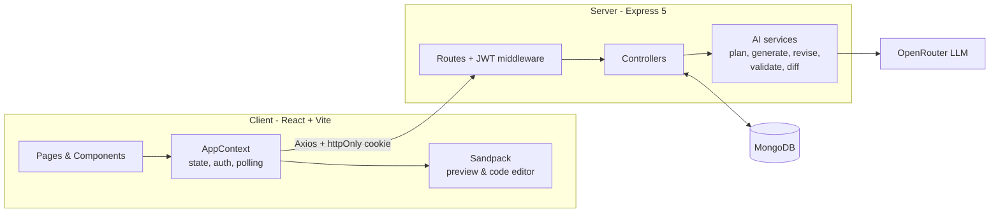
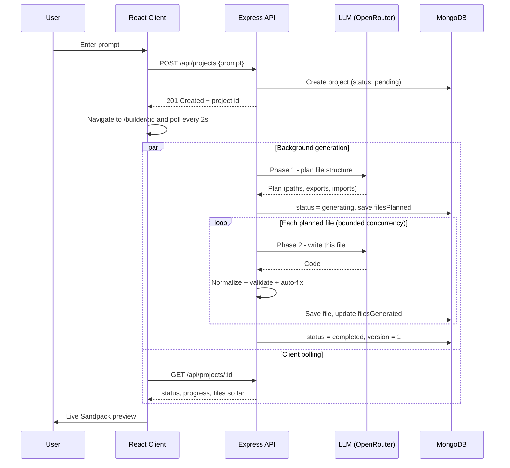

<div align="center">


# SiteSpark — AI Website Builder

**Describe a website in plain English. Watch an AI agent plan it, write the React code, and preview it live — then tweak it by chatting, edit the code by hand, publish it with one click, or export it as a ZIP.**


</div>

---

## Table of Contents

- [Overview](#overview)
- [Features](#features)
- [Tech Stack](#tech-stack)
- [Architecture](#architecture)
- [How the AI Pipeline Works](#how-the-ai-pipeline-works)
- [Project Structure](#project-structure)
- [Getting Started](#getting-started)
- [Environment Variables](#environment-variables)
- [API Reference](#api-reference)
- [Frontend Routes](#frontend-routes)
- [Data Models](#data-models)
- [Deployment Notes](#deployment-notes)
- [Security Notes](#security-notes)
- [Known Issues & Roadmap](#known-issues--roadmap)
- [Contributing](#contributing)
- [License](#license)
- [Author](#author)

---

## Overview

**SiteSpark** is a full-stack (MERN) web application that turns a text prompt into a working React website.

A user signs up, types something like *"Create a portfolio website for a photographer"* (or a game like *"Tic Tac Toe"*), and an LLM — accessed through [OpenRouter](https://openrouter.ai) via the Vercel AI SDK — does the rest:

1. **Plans** the project's file structure.
2. **Generates** each file (React components + CSS) in parallel.
3. **Validates and auto-repairs** the generated code to avoid common LLM mistakes.
4. **Streams progress** to the UI, then renders the result in an in-browser sandbox ([Sandpack](https://sandpack.codesandbox.io)).

After that, the user can keep **chatting with the AI** to request changes (applied as targeted search-and-replace patches, not full rewrites), **edit the code manually** in an embedded editor (auto-saved), **publish** the site to a public link, or **export** the whole project as a runnable Vite + React ZIP.

<!--
  📸 Add screenshots here, e.g.:
  
  
-->

---

## Features

**Authentication**
- Register / login / logout with email and password
- Passwords hashed with `bcrypt`; sessions use a JWT stored in an **httpOnly cookie** (30-day expiry)
- Route guards on the client (`AuthLayout` / `GuestLayout`) and `authMiddleware` on the server

**AI website generation**
- Prompt box on the home page plus one-click suggestion chips (Portfolio, E-commerce, Blog, Landing Page, …)
- **Intent recognition** in the system prompt: small apps/games (calculator, todo, tic-tac-toe…) are built as a single working `/App.js`, while marketing sites get a full multi-component landing page (Hero, Features, Pricing, Testimonials, CTA, Footer)
- Two-phase generation: **plan → generate files in parallel**, with automatic retry rounds for failed files
- **Live progress dashboard** (planned files, per-file status, progress bar) powered by background generation + client polling
- Light-mode-by-default, design-system-driven prompts (typography scale, spacing, animations, Font Awesome icons, vetted Unsplash image IDs)

**Builder workspace**
- Split layout: **Chat / Files** sidebar on the left, **Live preview or Code editor** on the right
- Embedded **Sandpack** editor + preview with a file-tree explorer
- **Debounced auto-save** (1 s) of manual code edits back to MongoDB
- Conversational **revisions**: the AI returns `create` / `update` / `delete` operations that are applied to your files; every successful revision bumps the project **version** (v1, v2, …)
- Open the site in a **full-page preview** in a new tab

**Share & export**
- **Publish** a project to a public URL (`/publish/:id`) and copy the link from a modal
- **Export ZIP**: downloads a ready-to-run Vite + React project (`package.json`, `vite.config.js`, `index.html`, `src/…`) with dependencies auto-detected from your imports

**Project management**
- Home page lists all your projects (name, version, "updated x ago") with delete

---

## Tech Stack

| Layer | Technologies |
|-------|--------------|
| **Frontend** | React 19, Vite 8, Tailwind CSS v4 (`@tailwindcss/vite`), React Router v7, Axios, `@codesandbox/sandpack-react`, Lucide icons, react-hot-toast, JSZip + file-saver, lodash.debounce, Moment.js |
| **Backend** | Node.js (ES Modules), Express 5, Mongoose 9, `jsonwebtoken`, `bcrypt`, `cookie-parser`, `cors`, `dotenv` |
| **AI** | [Vercel AI SDK](https://ai-sdk.dev) (`ai`, `@ai-sdk/openai`) → [OpenRouter](https://openrouter.ai) · structured output via `generateObject` + **Zod** schemas · `p-map` for bounded concurrency |
| **Database** | MongoDB |
| **Hosting** | Vercel configs included for both `client/` and `server/` |

---

## Architecture



### Generation flow



---

## How the AI Pipeline Works

All AI logic lives in [`server/services/`](server/services).

### 1. Planning — `generateProject()` in `ai.js`
The model receives the user's prompt and returns a structured **file plan** (validated by a Zod schema): each file has a `path`, `description`, `exports`, and `imports`. The server guarantees `/App.js` and `/styles.css` are always present. The plan is saved to MongoDB immediately so the UI can show the checklist.

### 2. Parallel file generation
Files are generated concurrently using `p-map` (default **6 at a time**, configurable via `AI_MAX_CONCURRENCY`). Each file is saved to the database as soon as it finishes, so progress is visible in real time. Failed files are retried for up to **2 extra rounds**.

> Because files are generated in parallel, cross-file consistency (matching default exports and import paths) is enforced through the **import/export contract in the plan**, not by showing the model other files' code.

### 3. Post-processing — `contentNormalizer.js` & `codeValidator.js`
LLM output is rarely perfect, so every file is cleaned before it is saved:

| Fix | Example |
|-----|---------|
| Strip markdown code fences | ` ```jsx … ``` ` → raw code |
| Fix double-escaped newlines/quotes | `\\n` → real newline, `className=\"x\"` → `className="x"` |
| JSX attribute corrections | `class=` → `className=`, `for=` → `htmlFor=` |
| Self-close void elements | `` → `` |
| Ensure exactly one default export | Adds `export default Component` if missing |
| Remove invalid HTML comments in JSX | `<!-- … -->` removed |
| Strip stray TypeScript syntax | `: React.FC`, simple `: string` param types |
| Add missing `import React` | when JSX is present |
| **Repair import paths** | Re-points a wrong relative import to where the planned file actually lives |

### 4. Revisions — `reviseProject()` + `diff.js`
For chat-based edits, the model gets a **file manifest** (path, hash, size), the **full contents** of all files, and recent conversation, and must reply with a JSON list of operations:

```json
{
  "operations": [
    { "op": "update", "path": "/components/Hero.js", "search": "exact old code", "replace": "new code" },
    { "op": "create", "path": "/components/Faq.js", "content": "…full file…" },
    { "op": "delete", "path": "/components/Old.js" }
  ],
  "description": "Short summary shown in the chat"
}
```

`applyOperations()` applies them with a two-step matcher: **exact substring match first, then a whitespace-normalized line-by-line fallback**. Any operation that fails is reported back to the user in the chat instead of silently dropped.

### 5. Rendering — Sandpack
The generated files are loaded into Sandpack's `react` template. Tailwind CSS and Font Awesome 6 are injected as external resources, and any npm packages the code imports are **auto-detected** from `import` statements (`utils/sandpackUtils.js`).

All prompts (design system, intent rules, technical rules) are centralised in [`server/services/prompts.js`](server/services/prompts.js) so they are easy to tune.

---

## Project Structure

```text
.
├── client/                          # React + Vite frontend
│   ├── public/                      # logo.svg, favicon.svg, bg-img.webp
│   ├── src/
│   │   ├── api/api.js               # Axios instance (baseURL + credentials)
│   │   ├── assets/assets.js         # Suggestion tags for the home page
│   │   ├── components/
│   │   │   ├── AgentProgressDashboard.jsx   # Live "AI is building…" checklist
│   │   │   ├── BuilderHeader.jsx            # Preview / Publish / Export / Code toggle
│   │   │   ├── ChatPanel.jsx                # Chat history + revision input
│   │   │   ├── FileExplorer.jsx             # File tree
│   │   │   ├── FullPagePreview.jsx          # Full-screen Sandpack preview
│   │   │   ├── PreviewPanel.jsx             # Sandpack editor + preview + autosave watcher
│   │   │   ├── PromptInput.jsx              # Reusable prompt textarea (glass / default)
│   │   │   ├── PublishModal.jsx             # "Your website is live" modal
│   │   │   ├── SandpackErrorMonitor.jsx     # Hides transient network errors in the overlay
│   │   │   ├── LoginLeft.jsx, Loading.jsx
│   │   ├── context/AppContext.jsx   # Global state: auth, projects, polling, chat, autosave
│   │   ├── pages/
│   │   │   ├── AuthPage.jsx         # Login / Register
│   │   │   ├── HomePage.jsx         # Prompt box + project list
│   │   │   ├── BuilderPage.jsx      # Main workspace
│   │   │   ├── PreviewPage.jsx      # Private full-page preview
│   │   │   ├── PublishPage.jsx      # Public published site
│   │   │   └── Layout.jsx           # AuthLayout / GuestLayout route guards
│   │   ├── utils/
│   │   │   ├── sandpackUtils.js     # Detect npm deps from imports
│   │   │   └── exportProject.js     # Build & download the ZIP
│   │   ├── App.jsx, main.jsx, index.css
│   ├── vercel.json                  # SPA rewrites
│   └── vite.config.js
│
└── server/                          # Express + MongoDB backend
    ├── config/db.js                 # Mongoose connection
    ├── controllers/
    │   ├── authController.js        # register, login, logout, me
    │   ├── projectController.js     # CRUD, publish, background generation worker
    │   └── chatController.js        # AI revision endpoint
    ├── middleware/authMiddleware.js # JWT cookie verification
    ├── models/                      # User.js, Project.js
    ├── Routes/                      # authRoutes.js, projectRoutes.js
    ├── services/
    │   ├── ai.js                    # generateProject() / reviseProject()
    │   ├── aiSchemas.js             # Zod schemas for structured output
    │   ├── prompts.js               # System prompts (design system + rules)
    │   ├── codeValidator.js         # Auto-fix common LLM code errors
    │   ├── contentNormalizer.js     # Fix escaping issues in LLM JSON strings
    │   └── diff.js                  # Apply create/update/delete operations
    ├── server.js                    # App entry point
    └── vercel.json
```

---

## Getting Started

### Prerequisites

- **Node.js** v20.19+ (v22 LTS recommended)
- **MongoDB** 5.0+ — a free [MongoDB Atlas](https://www.mongodb.com/atlas) cluster works (5.0+ is needed because file paths such as `/App.js` are stored as document keys)
- An **OpenRouter API key** — create one at [openrouter.ai/keys](https://openrouter.ai/keys)
- `yarn` (the repo ships `yarn.lock` files) — `npm` works too

### 1. Clone the repository

```bash
git clone https://github.com/Ayush-verma25/AI-Website-Builder-App-MERN.git
cd AI-Website-Builder-App-MERN
```

### 2. Set up the backend

```bash
cd server
yarn install        # or: npm install
```

Create `server/.env` (see [Environment Variables](#environment-variables)):

```env
MONGODB_URI=mongodb+srv://<user>:<password>@<cluster>/<db>
JWT_SECRET=replace-with-a-long-random-string
ORIGINS=http://localhost:5173
OPENROUTER_API_KEY=sk-or-xxxxxxxxxxxxxxxx
OPENROUTER_MODEL=openrouter/free
PORT=3000
```

Start the API:

```bash
yarn dev            # nodemon (auto-reload)
# or
yarn start          # plain node
```

You should see `Successfully connected to MongoDB.` and `Server is running at 3000`. Visiting `http://localhost:3000/` returns **"Server is Live!"**.

### 3. Set up the frontend

In a second terminal:

```bash
cd client
yarn install        # or: npm install
```

Create `client/.env`:

```env
VITE_BASE_URL=http://localhost:3000
```

Start Vite:

```bash
yarn dev
```

Open **http://localhost:5173**, create an account, and enter your first prompt.

### Available scripts

| Where | Command | What it does |
|-------|---------|--------------|
| `server/` | `yarn dev` | Run API with nodemon |
| `server/` | `yarn start` | Run API with node |
| `client/` | `yarn dev` | Start Vite dev server |
| `client/` | `yarn build` | Production build to `client/dist` |
| `client/` | `yarn preview` | Preview the production build |
| `client/` | `yarn lint` | Run ESLint |

---

## Environment Variables

### `server/.env`

| Variable | Required | Default | Description |
|----------|:--------:|---------|-------------|
| `MONGODB_URI` | ✅ | — | MongoDB connection string |
| `JWT_SECRET` | ✅ | `fallback_secret` | Secret used to sign session JWTs. **Always set your own value.** |
| `ORIGINS` | ✅ | — | Comma-separated list of allowed CORS origins, e.g. `http://localhost:5173,https://your-app.vercel.app` |
| `OPENROUTER_API_KEY` | ✅ | — | Your OpenRouter API key |
| `OPENROUTER_MODEL` | ❌ | `openrouter/free` | Any OpenRouter model ID. Choose one that reliably supports **structured JSON output**. |
| `AI_MAX_CONCURRENCY` | ❌ | `6` | Max files generated in parallel |
| `PORT` | ❌ | `3000` | API port |
| `NODE_ENV` | ❌ | — | Set to `production` to mark the auth cookie as `secure` |

### `client/.env`

| Variable | Required | Default | Description |
|----------|:--------:|---------|-------------|
| `VITE_BASE_URL` | ✅ (in dev) | `""` (same origin) | Base URL of the backend API |

> ⚠️ Both `.env` files are git-ignored. **Never commit them** and never share them (or zip files containing them) publicly.

---

## API Reference

Base URL: `http://localhost:3000`. All protected routes read the JWT from the `token` **httpOnly cookie**, so requests must be sent with credentials (`withCredentials: true`).

### Auth — `/api/auth`

| Method | Endpoint | Auth | Description |
|--------|----------|:----:|-------------|
| `POST` | `/register` | ❌ | Create an account. Body: `{ name, email, password }`. Sets the session cookie. |
| `POST` | `/login` | ❌ | Sign in. Body: `{ email, password }`. Sets the session cookie. |
| `POST` | `/logout` | ❌ | Clears the session cookie. |
| `GET` | `/me` | ✅ | Returns the current user (without password). |

### Projects — `/api/projects`

| Method | Endpoint | Auth | Description |
|--------|----------|:----:|-------------|
| `GET` | `/public/:id` | ❌ | Get a **published** project's files (403 if not published). |
| `POST` | `/` | ✅ | Create a project from `{ prompt }` and start background AI generation. Returns immediately with `status: "pending"`. |
| `GET` | `/` | ✅ | List your projects (summary only: name, description, version, timestamps). |
| `GET` | `/:id` | ✅ | Full project: files, chat messages, status, progress fields. |
| `DELETE` | `/:id` | ✅ | Delete a project you own. |
| `PUT` | `/:id/files` | ✅ | Replace the project's files with `{ files: { "/App.js": "…" } }` (manual edits). |
| `POST` | `/:id/publish` | ✅ | Mark the project as published. |
| `POST` | `/:id/chat` | ✅ | Send a revision prompt `{ prompt }`; returns the updated project plus `applied` and `errors` lists. |

Errors are returned as `{ "error": "message" }` with an appropriate HTTP status.

---

## Frontend Routes

| Path | Access | Page |
|------|--------|------|
| `/login`, `/register` | Guests only (logged-in users are redirected to `/`) | Auth form |
| `/` | Authenticated | Home — prompt box, suggestion chips, project list |
| `/builder/:id` | Authenticated | Builder workspace (chat, files, preview/code) |
| `/preview/:id` | Authenticated | Full-page private preview |
| `/publish/:id` | **Public** | Published website |
| `*` | — | Redirects to `/` |

---

## Data Models

### `User`
| Field | Type | Notes |
|-------|------|-------|
| `name` | String | required |
| `email` | String | required, unique, lower-cased, trimmed |
| `password` | String | required, **bcrypt-hashed** (10 salt rounds) in a `pre('save')` hook |
| `createdAt` / `updatedAt` | Date | via `timestamps` |

### `Project`
| Field | Type | Notes |
|-------|------|-------|
| `name`, `description` | String | name is set from the AI's plan; description starts as the user's prompt |
| `files` | Mixed | `{ "/path/File.js": { content, hash } }` — `hash` is a 12-char MD5 prefix |
| `messages` | `[{ role, content, timestamp }]` | `role` is `user` or `assistant`; powers the chat panel |
| `version` | Number | `0` while generating → `1` when done → `+1` per successful revision |
| `owner` | ObjectId → `User` | every query is scoped to the owner |
| `published` | Boolean | gates the public endpoint |
| `status` | Enum | `pending` · `generating` · `revising` · `completed` · `failed` |
| `filesPlanned` | `[{ path, description }]` | the AI's plan (drives the progress UI) |
| `filesGenerated` | `[String]` | paths finished so far |
| `currentFile` | String \| null | file currently being written |
| `error` | String \| null | failure message when `status = failed` |

---

## Deployment Notes

The repo contains a `vercel.json` in both `client/` (SPA rewrite to `/`) and `server/` (`@vercel/node` build). A few things to keep in mind:

- **CORS:** put every deployed frontend URL in the server's `ORIGINS` variable.
- **Cross-site cookies:** the auth cookie is `SameSite=Lax`. If the frontend and API live on *different sites* (e.g. two separate `*.vercel.app` projects), browsers will not send a `Lax` cookie on cross-site XHR requests. Either serve both from the same site/custom domain, or change the cookie to `SameSite=None; Secure` in `authController.js`.
- **Long-running background work:** project generation runs **in-process** after the HTTP response is sent (`runBackgroundGeneration`). Serverless platforms may freeze or terminate a function once the response is returned, which can interrupt generation. For reliable production use, host the API on a long-running service (Render, Railway, Fly.io, a VPS, …) or move generation to a job queue.
- Set `NODE_ENV=production` so the session cookie is marked `secure` (HTTPS only).

---

## Security Notes

- Passwords are hashed with bcrypt; JWTs live in an **httpOnly** cookie (not accessible to JavaScript).
- All private project queries filter by `owner`, so users cannot read or modify each other's projects.
- Unpublished projects return `403` from the public endpoint.
- AI-generated code runs inside Sandpack's sandboxed iframe, not on your server.
- **Always set a strong `JWT_SECRET`** — the code falls back to a hard-coded default when it is missing.
- There is currently **no rate limiting** on auth or AI endpoints; consider adding one (e.g. `express-rate-limit`) before exposing the app publicly, since each generation consumes LLM credits.

---

## Known Issues & Roadmap

**Known issues / cleanup candidates**

- `server/controllers/chatControllers.js` is an unused, duplicate version of `chatController.js` (and imports from a non-existent `../model/` path) — safe to delete.
- In `server/services/ai.js`, the fallback-placeholder block that runs when `/App.js` fails to generate after all retries references a variable (`file`) that is out of scope, and there is a leftover unused `import { el } from 'zod/v4/locales'`.
- The upload and microphone buttons in `PromptInput` are UI placeholders and are not wired up yet.
- A published site cannot currently be *un*published from the UI.

**Ideas for future work**

- [ ] Stream progress with Server-Sent Events / WebSockets instead of 2-second polling
- [ ] Version history with snapshots and undo/redo (only a version counter exists today)
- [ ] Unpublish + custom slugs / domains for published sites
- [ ] Image/file upload as prompt context and voice input
- [ ] Rate limiting, request size limits, and per-user usage quotas
- [ ] Automated tests (unit tests for `diff.js` / `codeValidator.js` are a great start)
- [ ] Dockerfile + `docker-compose` for one-command local setup

---

## Contributing

Contributions, issues, and feature requests are welcome!

1. Fork the repo
2. Create a feature branch: `git checkout -b feature/amazing-feature`
3. Commit your changes: `git commit -m "Add amazing feature"`
4. Push to the branch: `git push origin feature/amazing-feature`
5. Open a Pull Request

---

## License

Distributed under the **MIT License** (as declared in `server/package.json`). Add a `LICENSE` file to the repository root so GitHub can display it.

---

## Author

**Ayush Verma** — [@Ayush-verma25](https://github.com/Ayush-verma25)

If you found this project useful, consider giving it a ⭐ on GitHub!
